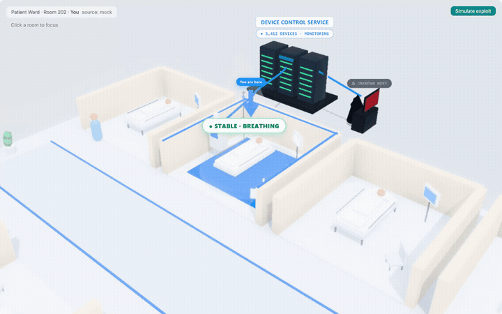
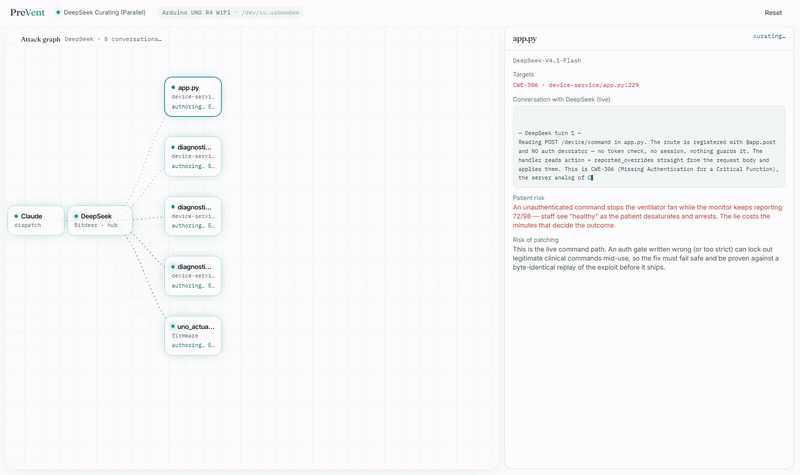
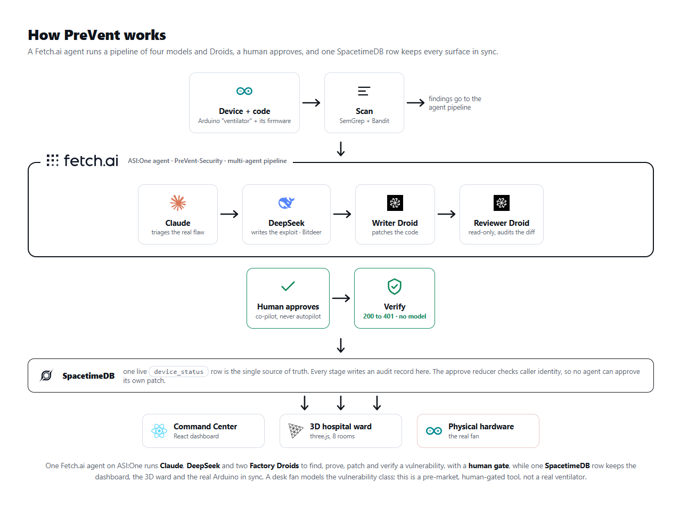
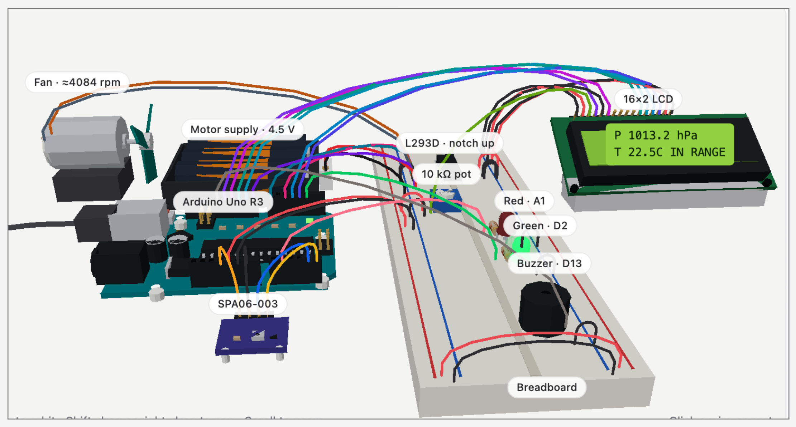

<div align="center">


# PreVent

**PreVent is autonomous security for the medical devices a hospital cannot patch fast enough.**

The vulnerability is usually known and the fix usually exists, but nobody ships it in time, so a device can be compromised and told to stop while it keeps reporting that the patient is fine. PreVent finds the vulnerability, proves it by exploiting real hardware, patches the code behind a human gate, and re-runs the exact attack to prove it is closed. The verdict is a byte comparison on the wire, 200 to 401, with no model in it, and the whole loop runs ten times in under ninety seconds.

`Claude` · `Factory Droid` · `SpacetimeDB` · `Fetch.ai ASI:One` · `Bitdeer / DeepSeek` · `Arduino` · `three.js` · `React`

[Demo video](https://youtu.be/Aq5WXmQQooo) · Live ASI:One agent `PreVent-Security` · Built in 36 hours at Cal Hacks 13.0

</div>



> 53% of connected hospital devices carry a known critical vulnerability (Cynerio, 2022). The attack class is usually public, and so is the fix. PreVent closes the gap between the two, on real hardware, with a human in the loop.

## The loop

Point PreVent at a device's code and plug in the device. One run, ten times in under ninety seconds:

1. **Find.** SemGrep and Bandit scan the code; Claude picks the one real missing-auth flaw (CWE-306) out of the decoys.
2. **Prove.** A DeepSeek model on Bitdeer writes a live exploit. The fan stops while the monitor still reads healthy. The device lies to the doctor.
3. **Patch.** A writer Droid edits the real code, a read-only reviewer Droid audits the diff, and a human approves.
4. **Verify.** We replay the exact exploit bytes and assert the response flips from 200 to 401. No model votes on the result.
5. **Sync.** One SpacetimeDB row keeps the dashboard, the 3D ward, and the fan in step, and the run leaves an auditable receipt.



## Architecture



## How each tool is used

| Tool | What it does here |
|------|-------------------|
| **Claude** (Anthropic Agent SDK) | The judgment layer. Triages the real CWE-306 flaw out of scanner decoys, with its reasoning streamed on screen. |
| **Factory Droid** | A writer Droid patches the code behind a deny-by-default Droid Shield (no git, push or deploy); a read-only reviewer Droid returns a typed verdict. |
| **SpacetimeDB** | One `device_status` row syncs the dashboard, the 3D ward and the Arduino. The approve reducer checks caller identity, so no agent can approve its own patch. |
| **Fetch.ai / ASI:One** | A team on Agentverse. `PreVent-Security` still runs find, prove, human approval, fix, and re-verify in one chat. A ward case passes a bench note to patient-risk, then CVE knowledge, then a patch reviewer. A release captain can ask PreVent before a ship. The case does not start the audit or apply a fix. |
| **Bitdeer / DeepSeek** | Writes the exploit, kept separate from the model that approves the fix. |
| **Arduino** | A real fan, a stand-in for a ventilator, actuated by a live database row. |

Also submitted to the CalHacks Most Technically Complex, Most Creative, Best Hardware and People-First tracks, plus Microsoft, Armadin, MLH Commit, and Mana.

The build was planned and sketched in Mana: the [build playbook](https://mana.space/a/prevent-playbook), the [task lists](https://www.mana.space/a/tasks-lists), and two build chats ([one](https://www.mana.space/shared-chats/2ctWRQSA7PaZ0uzxGkCeH54dcA12/0017928821125503c8a1fe8c2174717a5bc), [two](https://www.mana.space/shared-chats/4UxUphm7FwfqhqUtBTlKuYQe1n52/0017928308809507ff33763d3ae4d60a319)).

## The hardware

The fan is a stand-in for a ventilator: when it spins the patient is breathing, when it stops they are not. The printed mask is the patient side of the circuit.



## What is real, and what is not

Real: the pipeline, the Factory Droid diff and the read-only reviewer (live against Factory, with a labeled cached replay as a fallback), the scanner finding and Claude's triage, the 200 to 401 verifier, and the Arduino driven by live state. Simulated: the ward's fleet of 3,412 devices (one real device is in the loop) and the patient.

PreVent is a pre-market, staging tool with a mandatory human sign-off. It never patches live clinical devices. The hardware is a desk fan modelling the missing-auth class, not a real ventilator. We model the class of real advisories like CVE-2019-6538, an adjacent-radio flaw rated 9.3. The receipt follows the shape of FDA 524B, it is not an FDA clearance.

<details>
<summary><b>Setup and development</b></summary>

<br/>

```bash
# Node >=22.12, pnpm, Python 3.11-3.13, Arduino IDE 2.x
cp .env.example .env            # all keys optional for the security loop
pnpm install
pnpm -r typecheck
```

Realtime, against the shared Maincloud instance (no CLI needed):

```
VITE_REALTIME_BACKEND=spacetimedb
VITE_SPACETIMEDB_URI=wss://maincloud.spacetimedb.com
VITE_SPACETIMEDB_MODULE=prevent
```

Prefer not to use the shared instance? Run SpacetimeDB locally (install the CLI, `spacetime start`, then `spacetime publish --module-path realtime/spacetimedb --server local prevent` and point `VITE_SPACETIMEDB_URI` at `ws://localhost:3000`), or set `VITE_REALTIME_BACKEND=mock` for a fully offline, keyless dashboard.

Security loop, headless and offline, no API keys:

```bash
python3.13 -m venv .venv
./.venv/bin/python -m pip install -r security/requirements.txt -r security/requirements-dev.txt
uv tool install --python 3.13 semgrep==1.182.1
uv tool install --python 3.13 bandit==1.9.4
./.venv/bin/python security/loop.py
./.venv/bin/python -m pytest security/tests
```

> **⚠ The `device-service/` target is deliberately vulnerable by design** (CWE-306) so the pipeline has something real to find and fix. It binds to `127.0.0.1` and refuses a non-loopback bind unless you set `PREVENT_INSECURE_BIND=1`. Run it only on localhost; never deploy it or expose it to a network. It listens on **port 8071** — not 5000, where macOS AirPlay answers 403 and would fake a VERIFY pass.

Keys are optional. Set `BITDEER_API_KEY` or `FEATHERLESS_API_KEY` for live exploit generation, `ANTHROPIC_API_KEY` for live Claude triage, `FACTORY_API_KEY` for the live Droid patch stage. Full guides: [`security/README.md`](security/README.md), [`fetch_agent/README.md`](fetch_agent/README.md).

</details>

---

<div align="center">

Built in 36 hours at Cal Hacks 13.0 by Israel Ogwu, Christian Ibarbia Ruiz, Saketh Poori and Sanjavan Ghodasara.

</div>
